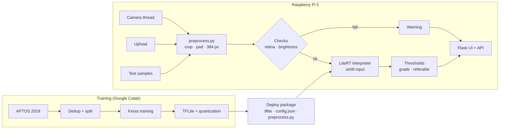

# RetinaEdge

**Diabetic retinopathy grading on a Raspberry Pi 5, fully offline.**

A fundus photograph is graded on the ICDR scale (0 No DR · 1 Mild · 2 Moderate · 3 Severe ·
4 Proliferative DR) and flagged as **referable** (grade ≥ 2) by a quantized CNN running locally
with LiteRT. A Flask web app shows the live camera feed, the grade, the referral decision and the
device metrics.

Final project of Part 1 of **IESTI05 – Edge AI Engineering** (UNIFEI, Prof. Marcelo José Rovai),
and the first step of an undergraduate thesis on cross-domain validation of DR screening at the edge.

> ⚠️ Research prototype. Not a medical device and not validated for clinical use.

## Highlights

- **QWK 0.894 and referable AUC 0.974 on the test set** with a 4.5 MB MobileNetV2 (float16),
  practically the same as a ResNet-50 ten times larger.
- **Input resolution mattered more than architecture:** going from 224 to 384 px closed the gap
  between MobileNetV2 and ResNet-50.
- **INT8 can keep the AUC and still hurt screening:** full INT8 shifts the probabilities, so the
  referral cut-off calibrated on the float model loses sensitivity (0.93 → 0.84).
- **185 duplicate images removed before the split**, including 42 pairs of the same retina with
  different grades in the original labels.

## How it works



The same `preprocess.py` runs in Colab and on the Pi, and the decision rules (grading thresholds
and referral cut-off) are fitted on validation and shipped in `config.json`, so the Pi reproduces
the evaluated pipeline exactly.

## Data

[APTOS 2019 Blindness Detection](https://www.kaggle.com/competitions/aptos2019-blindness-detection)
(3,662 images). Images are **not** included in this repository; download them from Kaggle.

The dataset contains the same retina more than once. Duplicates were found with MD5 + perceptual
hashing on the cropped retina:

| Pair type | Pairs | Images removed |
|---|---|---|
| Same grade | 118 | 108 (one copy kept) |
| Different grades | 42 | 77 (both removed) |
| **Total** | **160** | **185** |

Seven of the conflicting pairs disagree on the referral decision itself. The remaining 3,477 images
were split 70 / 15 / 15, stratified by grade.

| | Duplicates, same grade | Duplicates, different grades |
|---|---|---|
| |  |  |


## Results (held-out test set)

Keras models (thresholds and referral cut-off fitted on validation):

| Model | Input | QWK (argmax) | QWK (thresholds) | Accuracy | AUC referable | Sensitivity | Specificity |
|---|---|---|---|---|---|---|---|
| ResNet-50 | 384 px | 0.887 | 0.901 | 0.791 | 0.979 | 0.946 | 0.915 |
| MobileNetV2 | 384 px | 0.869 | 0.895 | 0.795 | 0.974 | 0.926 | 0.928 |
| ResNet-50 | 224 px | 0.866 | 0.900 | 0.791 | 0.974 | 0.926 | 0.925 |
| MobileNetV2 | 224 px | 0.835 | 0.864 | 0.701 | 0.967 | 0.911 | 0.900 |

TFLite variants deployed on the Pi (384 px, chosen on validation, evaluated once on test):

| Model | Variant | Size | QWK (thresholds) | Accuracy (argmax) | AUC | Sensitivity | Specificity |
|---|---|---|---|---|---|---|---|
| MobileNetV2 | float16 | 4.5 MB | 0.894 | 0.812 | 0.974 | 0.926 | 0.928 |
| MobileNetV2 | full INT8 | 2.7 MB | 0.866 | 0.803 | 0.971 | 0.837 | 0.944 |
| ResNet-50 | dynamic range | 23.9 MB | 0.897 | 0.818 | 0.978 | 0.951 | 0.912 |


The ROC curves show the INT8 effect: the curve barely moves, but the operating point fitted on the
float model slides down to lower sensitivity.


Full ResNet-50 INT8 dropped validation QWK from 0.88 to 0.71; dynamic-range quantization (weights
only) was lossless, which places the problem in the activations.

### On the Raspberry Pi 5

| Model | Inference (ms) | End-to-end FPS | CPU (%) | Model RAM (MB) |
|---|---|---|---|---|
| MobileNetV2 float16 | TBD | TBD | TBD | TBD |
| MobileNetV2 INT8 | TBD | TBD | TBD | TBD |
| ResNet-50 dynamic | TBD | TBD | TBD | TBD |

Full numbers: [`results/benchmark_results.csv`](results/benchmark_results.csv).

## Hardware

| Component | Specification |
|---|---|
| Board | Raspberry Pi 5, 8 GB RAM |
| Camera | Raspberry Pi Camera Module (CSI) |
| Cooling | case with active fan |
| Storage | 64 GB microSD |
| Power | 5 V / 5 A USB-C |
| Capture target | monitor showing fundus photographs |

The camera mode re-captures fundus photographs shown on a monitor, a simulation of a fundus camera.

## Quick start

```bash
sudo apt install -y python3-picamera2 python3-venv
git clone <repo-url> && cd retinaedge/app
unzip -n retinaedge_384.zip          # config.json, models/, samples/ (deploy package)
python3 -m venv --system-site-packages .venv && source .venv/bin/activate
pip install -r requirements.txt
python -m pytest -q tests            # 37 unit tests
python app.py                        # http://<pi-ip>:5000
```

| Command | What it does |
|---|---|
| `python app.py` | web app with live camera, upload and test samples |
| `python app.py --model resnet50_384_dynamic` | start with another model (it can also be switched in the page) |
| `python app.py --no-camera` | upload and samples only |
| `python app.py --benchmark --runs 5` | latency, FPS, CPU, RAM and temperature for every model |

The app reports a clear message instead of a grade when no retina is found or the image is too dark,
and flags low-confidence predictions. Details and API routes: [`app/README.md`](app/README.md).

## Repository

```
app/        Raspberry Pi application: Flask, camera, LiteRT inference, benchmark, unit tests
training/   Colab notebook and dataset scripts
results/    CSV files and figures behind the report
docs/       Technical report
```

Models (`.tflite`) and APTOS images are kept out of Git; the deploy package is generated by the
`Deploy Package` cell of the training notebook.

## Limitations

- Single source domain (APTOS). Performance on other cameras and populations is the subject of the
  thesis (Messidor-2, domain adaptation).
- Screen re-capture adds glare, moiré and colour loss compared with a real fundus camera.
- The referral cut-off of the INT8 model was not recalibrated.

## License

Code released under the [MIT License](LICENSE). The APTOS 2019 images are not part of this
repository and remain subject to the [Kaggle competition rules](https://www.kaggle.com/competitions/aptos2019-blindness-detection/rules).

## Author

Mirela Vitória Domiciano, Computer Engineering, UNIFEI.